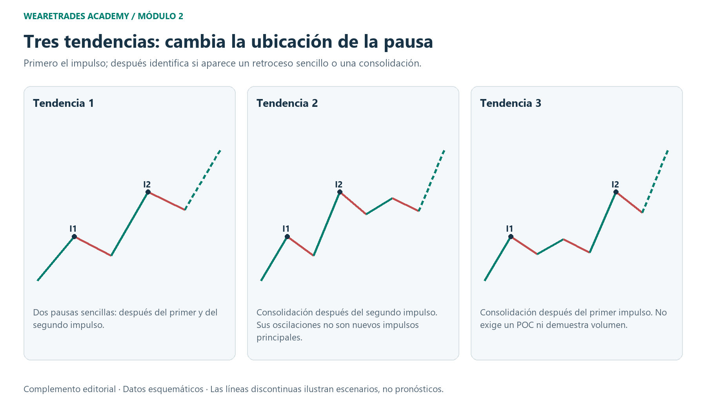
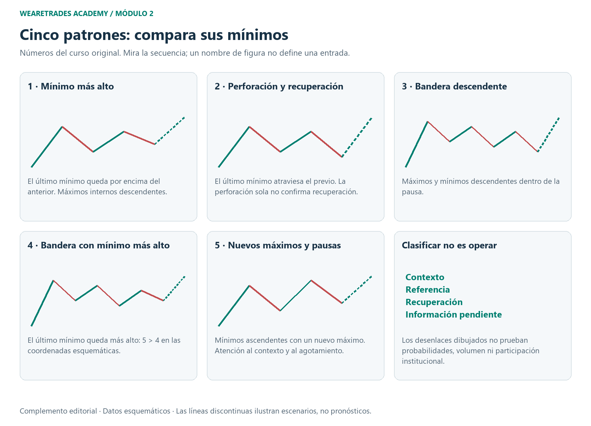
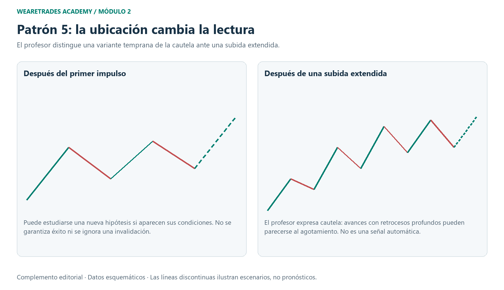
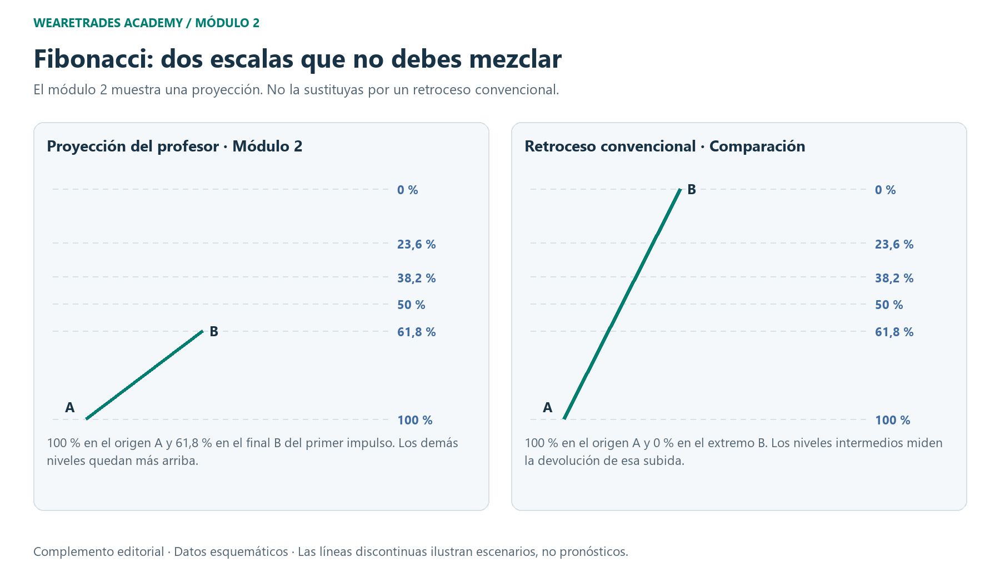
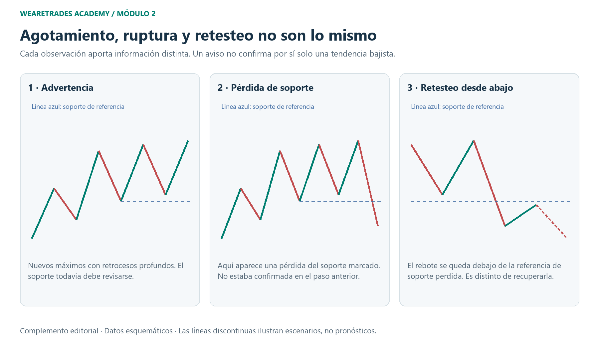

# Módulo 2. Tipos de Tendencias Alcistas

**Estado: borrador editorial con integración visual parcial en `/curso/modulo-2`.** Esa vista incorpora explicaciones, imágenes y práctica de comprensión, sin sustituir el catálogo ni migrar progreso. Este documento conserva el desarrollo amplio y el orden de las dos partes recibidas. Los bloques siguientes son divisiones para estudiar, no títulos ni cantidades de clases atribuidos a la grabación original.

Fuentes principales: [parte 1](fuentes/002-modulo-02-alcistas-parte-01-original.txt) y [parte 2](fuentes/003-modulo-02-alcistas-parte-02-original.txt). Complemento visual: [manual original](../../public/course-originals/01-APRENDE_NUEVAS_ESTRATEGIAS_TRADING-1-.pdf), páginas indicadas en cada bloque. Consulta las decisiones y lagunas en [trazabilidad editorial](002-modulo-02-trazabilidad.md).

## Qué vas a aprender y por qué viene después de la introducción

La introducción planteó que una decisión debe respetar un orden de condiciones. Este módulo empieza a darle contenido a ese orden: primero reconocer el movimiento principal, después estudiar su pausa y, finalmente, comprobar dónde ocurre y qué referencia falta recuperar. La pregunta no será solamente «¿está subiendo?», sino «¿cómo está subiendo y qué ha cambiado durante la pausa?».

Al terminar deberías poder distinguir las tres secuencias alcistas del profesor, comparar sus cinco patrones de continuación, reconocer señales de agotamiento sin anticipar un giro y explicar por qué dos figuras parecidas pueden merecer lecturas diferentes según su ubicación.

**Alcance:** este material enseña lectura y formulación de escenarios. No constituye por sí solo un sistema de ejecución completo: faltan criterios uniformes de confirmación, invalidación, tamaño de posición y costes. No convierte los esquemas en pronósticos ni demuestra rentabilidad.

### Vocabulario mínimo — apoyo editorial

| Término | Qué debes mirar |
| --- | --- |
| Impulso | Tramo que avanza en la dirección del movimiento principal que has elegido analizar. |
| Retroceso | Tramo contrario dentro de ese movimiento; su existencia no demuestra por sí sola un cambio de tendencia. |
| Máximo o mínimo de referencia | Un extremo concreto que marcas antes de evaluar el siguiente movimiento. Debes poder señalar cuál es. |
| Continuación | Hipótesis de reanudación del movimiento después de una pausa; no una obligación del precio. |
| Soporte o resistencia | Referencia previa que se usa para estudiar una posible reacción. Su efecto debe observarse, no darse por seguro. |

Trabaja siempre con una escala de análisis explícita. Una oscilación pequeña puede formar parte de un impulso mayor; cambiar de escala sin avisar vuelve contradictorio el conteo.

## Parte 1. Cómo se organiza una tendencia alcista

### Bloque A. Tres secuencias, una misma pregunta

Complemento editorial nuevo. Las tres imágenes aportadas para este bloque se conservan con notas en la vista de estudio y en el [inventario visual](002-modulo-02-integracion-visual.md).

El profesor diferencia las tendencias según el lugar en el que aparece una pausa sencilla o un patrón más elaborado. El manual las representa juntas en la página 11.

| Tipo del curso | Secuencia esquemática | Qué la distingue |
| --- | --- | --- |
| Tendencia 1 | Primer impulso → retroceso sencillo → segundo impulso → retroceso sencillo → tercer impulso | Las pausas del ejemplo no desarrollan una consolidación amplia. |
| Tendencia 2 | Primer impulso → retroceso sencillo → segundo impulso → patrón de continuación → tercer impulso | La pausa más compleja aparece después del segundo impulso. |
| Tendencia 3 | Primer impulso → patrón de continuación → segundo impulso → nueva pausa → posible tercer impulso | La consolidación aparece antes, después del primer impulso. |

Estas son las secuencias que presenta el curso, no una clasificación universal ni una promesa de tres impulsos. El profesor admite variaciones, incluida la aparición de más de una consolidación.

**Por qué importa:** si esperas que una subida avance sin pausas, puedes interpretar cualquier vela roja como el comienzo de una caída. Si reconoces la fase que estás estudiando, puedes preguntar si la pausa conserva las referencias del movimiento o empieza a deteriorarlas.

**Contraejemplo:** una vela roja después de una subida no basta para declarar una tendencia bajista. Tampoco basta una vela verde después de una caída para declarar una tendencia alcista. En ambos casos falta la secuencia y su relación con los extremos anteriores.

**Anticipar, en el sentido de esta clase, significa preparar escenarios.** No significa entrar antes de que ocurra la condición que el propio escenario exige. No haber participado en el primer impulso tampoco equivale a haber perdido dinero; evita usar esa sensación como justificación para perseguir el siguiente máximo.

### Bloque B. Los cinco patrones de continuación

La página 13 del manual compara los cinco dibujos. Las páginas 14–18 los desarrollan. Los números pertenecen a este curso: aprende primero las diferencias observables, no solamente los nombres.

| Patrón | Rasgo que permite distinguirlo en el esquema original | Pregunta para leerlo |
| --- | --- | --- |
| 1 | Máximos internos descendentes y un mínimo final más alto; la pausa se estrecha. | ¿Qué máximo interno tendría que recuperar el precio después de ese mínimo más alto? |
| 2 | Una caída atraviesa el mínimo local anterior y luego se recupera; el profesor la denomina «engaño». | ¿Ya se observa recuperación o solo estoy viendo la perforación? |
| 3 | Bandera descendente: máximos y mínimos decrecientes dentro de la pausa. | ¿Se ha recuperado el máximo local relevante o sigue intacta la secuencia descendente? |
| 4 | Variante de bandera en la que el último mínimo queda más alto que el anterior y ya no alcanza la parte inferior del canal. | ¿Puedo señalar ese mínimo más alto y el máximo que sigue pendiente? |
| 5 | Oscilaciones con mínimos ascendentes y un nuevo máximo por encima del anterior, seguidas de otro retroceso marcado. | ¿Está al principio del movimiento o forma parte de una subida extendida que pierde continuidad? |

Una línea de tendencia y un máximo horizontal no son la misma referencia. En una explicación o ejercicio debes marcar ambos cuando sean relevantes y decir cuál estás evaluando. La transcripción no establece para todos los ejemplos si superar significa tocar, atravesar intravela o cerrar por encima; no se inventa aquí una regla común de entrada.

En los patrones 1 y 4 hay un mínimo final más alto, pero no son idénticos: el 4 procede de la secuencia de bandera que muestra el manual. En el patrón 2, una mecha inferior aislada no demuestra que la recuperación ya esté confirmada. El término «engaño» describe la lectura del profesor; la forma de la vela no demuestra la intención de un participante.

**Precaución con las letras M y W:** el profesor advierte que una figura parecida a una M dentro de una tendencia alcista puede formar parte de la pausa. Reconocer una silueta no sustituye el análisis del contexto ni habilita automáticamente una venta.

#### El caso especial del patrón 5

El manual lo incluye en la clasificación, pero el profesor expresa que no le gusta operarlo al final del segundo impulso o en el desarrollo de uno tercero: puede parecerse al agotamiento por dientes de sierra que se estudiará en la segunda parte. **Clasificar una forma y decidir utilizarla son tareas distintas.**

Después de un primer impulso, cerca de referencias de soporte, analiza variaciones que podrían permitir otra hipótesis de continuación. La página 19 muestra incluso una revisión del conteo. Eso no autoriza a ignorar una invalidación anterior: un nuevo escenario requiere nueva información y debe registrarse como tal, no como una justificación retrospectiva.

### Bloque C. No contar cada oscilación como un impulso principal

Un segundo impulso puede contener pequeñas subidas, retrocesos y patrones internos. Si llamas «segundo», «tercero» y «cuarto» a cada giro pequeño sin conservar la escala inicial, terminas describiendo otro movimiento.

Para estudiar un ejemplo, señala el origen elegido, el final del primer impulso y la escala de las referencias. Si más adelante una ruptura obliga a revisar el conteo, deja escrito **en qué momento** cambió tu lectura. No presentes esa revisión posterior como si la hubieras conocido desde el inicio.

#### Qué muestra realmente Fibonacci en este material

La página 20 resuelve una parte de la explicación verbal: el esquema coloca **100 % en el origen inferior** y **61,8 % en el final del primer impulso**; 50 %, 38,2 %, 23,6 % y 0 % quedan sucesivamente por encima. Es la escala de proyección que muestra el profesor, no un retroceso convencional del 61,8 % trazado desde un máximo hacia un mínimo.

La segunda parte también habla de medir retrocesos. Por tanto, hay que distinguir el uso de proyección para estudiar impulsos del uso de retroceso para estudiar una corrección. No mezcles ambos porque compartan porcentajes.

El dibujo permite explicar la orientación y las referencias, pero no entrega por sí solo una configuración completa de la herramienta ni garantiza que se alcance ningún nivel. Los porcentajes mal transcritos y los anclajes de ejemplos concretos quedan pendientes antes de convertirlos en ejercicios numéricos operativos.

### Bloque D. Una figura necesita ubicación y espacio

Antes de valorar una continuación, el profesor observa niveles anteriores: soportes, resistencias y zonas de congestión. Una dirección alcista favorable no implica que exista suficiente recorrido hasta el siguiente obstáculo.

**Ejemplo conceptual — complemento editorial:** dos gráficos muestran el mismo mínimo más alto. En uno hay una resistencia inmediatamente encima; en el otro, la referencia marcada está más lejos. La forma es semejante, pero el espacio del escenario no lo es. Este contraste no permite asignar una probabilidad ni una distancia mínima universal.

En la transcripción aparecen «PO», «poco» y referencias al centro de una congestión. Mientras no se confirme el término y su construcción, se utiliza la descripción **zona de concentración visual de velas**. No se convierte ese centro en un POC de volumen calculado sin datos de volumen y una definición verificable.

## Parte 2. Cuándo desconfiar de una continuación aparente

### Bloque E. Rebotes después de caídas fuertes

La segunda parte comienza con una dificultad: después de una caída prolongada puede aparecer una W o una recuperación inicial sin que se desarrolle una tendencia alcista sostenida.

El profesor pide volver a observar los mínimos, la recuperación de máximos locales y la relación con el soporte. Una reacción inicial no resuelve por sí sola si la recuperación tendrá continuidad. El contexto de caída previa no desaparece al aparecer una figura.

**Contraejemplo:** «ha caído mucho, por tanto ya tiene que subir» no describe una condición observable de continuación. En un ejercicio, esperar información adicional es una respuesta válida si explicas qué referencia falta recuperar.

Las observaciones del profesor sobre horarios, escaso volumen y pendiente pertenecen a sus ejemplos. Sin activo, sesión, datos y configuración del gráfico no se transforman en reglas horarias o umbrales universales.

### Bloque F. Dientes de sierra y agotamiento

La página 25 muestra una secuencia en la que el precio supera máximos, pero los avances van acompañados de retrocesos profundos. La dificultad no es solo cuánto sube, sino cuánto de ese avance conserva.

Observa el conjunto: avances con poco seguimiento, retrocesos que vuelven sobre buena parte del tramo anterior, solapamiento y cercanía a resistencias después de una subida extendida. El profesor utiliza esos rasgos como advertencias de agotamiento.

**Advertencia no equivale a giro confirmado.** La misma secuencia puede terminar en una consolidación mayor, continuar o deteriorarse. Un máximo más bajo o una rotura de directriz son información nueva, pero el soporte y la estructura restante todavía deben analizarse. Tampoco existe en esta entrega una ley por la que el cuarto diente siempre deba caer.

El contraste con el patrón 5 queda ahora conectado: una forma con mínimos ascendentes puede estar perdiendo capacidad de avanzar cuando aparece tarde en el movimiento. No basta con decir «los mínimos suben» para omitir el resto del contexto.

### Bloque G. Leer un rango dentro de otro rango

La explicación pasa de la figura a un mapa de referencias. Primero delimita extremos anteriores; después identifica si dentro hay otra zona de congestión. Esta zona interior puede crear un obstáculo antes de llegar al extremo exterior.

Orden para documentar la lectura del ejemplo:

1. Marca el soporte y la resistencia externos que ya eran visibles.
2. Señala los límites de la congestión interior, si existe.
3. Ubica el precio respecto a esas referencias.
4. Describe qué reacción o ruptura se observa y qué falta comprobar.
5. Explica si el espacio disponible permite desarrollar el escenario que estás estudiando o si la información sigue siendo insuficiente.

Las etiquetas «zona de demanda» y «zona de oferta» se conservan como vocabulario del método. No significan que fuera de una línea deje de haber compradores o vendedores, ni prueban quién está operando.

### Bloque H. Tres alternativas después de superar una resistencia

En los ejemplos el profesor contempla tres desarrollos diferentes:

| Alternativa | Desarrollo que se espera observar | Confusión que debes evitar |
| --- | --- | --- |
| Retesteo de la referencia | El precio vuelve a la resistencia superada y se estudia su posible actuación como soporte, junto con la recuperación de la referencia local. | Comprar por el simple contacto. |
| Retroceso que termina por encima | La pausa deja un mínimo sin volver exactamente al antiguo nivel y después recupera su referencia local. | Exigir siempre un contacto exacto. |
| Consolidación sobre la ruptura | Se forma un patrón de continuación por encima de la antigua resistencia. | Perseguir cualquier vela que se aleja del nivel. |

**Son alternativas, no tres pasos obligatorios que deban ocurrir juntos.** Si no aparece una secuencia interpretable, la lectura puede permanecer pendiente. Los resultados de operaciones que relata el profesor son ejemplos narrados, no una muestra auditada de rentabilidad.

## Laboratorio guiado — complemento editorial, datos ficticios

Estas actividades evalúan comprensión. No reconstruyen operaciones reales ni sustituyen el video de prácticas que menciona el profesor. No calculan beneficios ni proponen entradas con dinero real.

### Actividad 1. Comparar dos pausas sin adivinar el futuro

**Datos comunes:** en una escala ya fijada, un impulso va de 100 a 110, retrocede a 106 y avanza hasta 120. El antiguo máximo 110 y una resistencia 122 están marcados antes de empezar la actividad.

**Caso A:** los siguientes extremos locales, en orden, son 112 → 118 → 114. La última observación disponible es 117. El máximo local pendiente es 118.

**Caso B:** los siguientes extremos locales son 114 → 118 → 112. La última observación disponible es 117. El máximo local pendiente también es 118. Para este ejercicio, 112 permanece por debajo del mínimo previo 114; no se aporta recuperación posterior de 118.

**Regla exclusiva del ejercicio:** para comparar referencias usamos un cierre estrictamente superior a 118. Se fija esta convención para que la respuesta sea verificable; no se atribuye al profesor como regla general.

**Entrega:** escribe para cada caso cuatro frases: relación entre los dos mínimos locales, patrón con el que es compatible, condición aún ausente y obstáculo ya conocido. No dibujes velas futuras.

**Resolución razonada:**

- A deja un mínimo más alto: 114 > 112. Es compatible con la pausa del patrón 1, dentro del contexto indicado. La última observación 117 no aporta el cierre exigido sobre 118. La resistencia 122 sigue formando parte del mapa.
- B perfora el mínimo previo: 112 < 114. Es un candidato a estudiar como patrón 2 si desarrolla la recuperación correspondiente; no es idéntico a A y no está confirmado por los datos disponibles. Falta igualmente el cierre sobre 118; 122 sigue siendo el obstáculo conocido.
- Ninguno de los dos casos permite afirmar que habrá continuación, que se alcanzará 122 o que una operación sería rentable.

**Segundo corte, solo después de responder:** se añade un cierre en 119. Ahora se ha cumplido la condición local del ejercicio. La respuesta actualizada debe reconocer ese cambio sin borrar la respuesta anterior. No debe inventar que también se ha superado 122 ni convertir una condición cumplida en un sistema operativo completo.

### Actividad 2. Reconocer el tipo de secuencia

Clasifica estas descripciones y explica dónde aparece la pausa compleja:

1. Impulso, pausa sencilla, impulso, pausa sencilla, impulso.
2. Impulso, pausa sencilla, impulso, consolidación, impulso.
3. Impulso, consolidación, impulso, pausa sencilla, impulso.

**Respuesta:** tipos 1, 2 y 3, respectivamente. El criterio es la ubicación de la consolidación dentro de la secuencia, no el número de velas verdes. Las descripciones están completas para clasificar el dibujo; no son predicciones sobre un gráfico vivo.

### Actividad 3. Separar advertencia de conclusión

**Caso:** después de una subida extendida, tres avances superan ligeramente el máximo anterior, pero cada retroceso devuelve buena parte de la subida. Hay una resistencia cercana. Todavía no se ha perdido el soporte marcado.

**Pregunta:** ¿qué puedes afirmar y qué no?

**Respuesta esperada:** hay rasgos compatibles con la advertencia de agotamiento explicada por el profesor. No puede afirmarse que ya exista una tendencia bajista ni que el siguiente movimiento vaya a romper el soporte. Sigue abierta la posibilidad de una consolidación. Debes conservar el soporte en el análisis y decir qué nueva observación cambiaría tu lectura.

### Actividad 4. Identificar alternativas, no acumular requisitos

**Caso:** se supera una resistencia. La pausa posterior termina por encima del antiguo nivel, sin tocarlo, y después recupera el máximo local marcado.

**Pregunta:** ¿queda descartado el escenario solo porque no hubo un retesteo exacto?

**Respuesta esperada:** no por ese motivo; corresponde a la segunda alternativa descrita en el bloque H. Eso tampoco prueba que el escenario sea suficiente para operar: aún deben revisarse las demás condiciones, que esta actividad no aporta.

### Cómo revisar tu trabajo

Una respuesta completa identifica referencias concretas, distingue dato de hipótesis, explica qué falta observar y no utiliza información posterior al corte. Si solo escribes «alcista», «bajista» o «entraría», falta el razonamiento que se busca practicar.

Para practicar con los gráficos originales, oculta su continuación antes de escribir la lectura y registra cuándo cambias de opinión. Esta forma de estudio es un complemento editorial; observar ejemplos históricos completos sirve para reconocer figuras, pero no demuestra que se hubieran identificado a tiempo.

## Antes de pasar al siguiente módulo

Comprueba que puedes explicar por qué una continuación no se reconoce solo por su forma, por qué el patrón 5 exige diferenciar ubicación temprana y tardía, y por qué superar un máximo local no equivale a haber resuelto todos los obstáculos.

El siguiente tema de la estructura es **Principales retrocesos alcistas**. Este módulo permite reconocer dónde aparece una corrección; el siguiente deberá desarrollar sus características con la nueva información que aporte el usuario. No se adelantan reglas de profundidad ni clases de velas póker u Order Block que pertenecen a entregas posteriores.

## Material pendiente antes de publicar esta reconstrucción

- El video de prácticas separado que anuncia el profesor y las demás clases, si estas dos partes no abarcan todo el módulo.
- Los gráficos de los ejemplos hablados que no se puedan identificar de forma inequívoca en el manual, especialmente para resolver la numeración 3/4 usada en algunos ejercicios.
- Configuración y reglas completas antes de construir evaluaciones sobre anclajes Fibonacci, confirmación de rupturas o invalidación de operaciones.
- Confirmación del término que la transcripción convierte en «PO» o «poco». No se completa automáticamente como POC de volumen.

Las láminas y videos anteriores se conservan. Solo deberán asignarse a este módulo después de comprobar que enseñan estas mismas referencias, números y condiciones.
